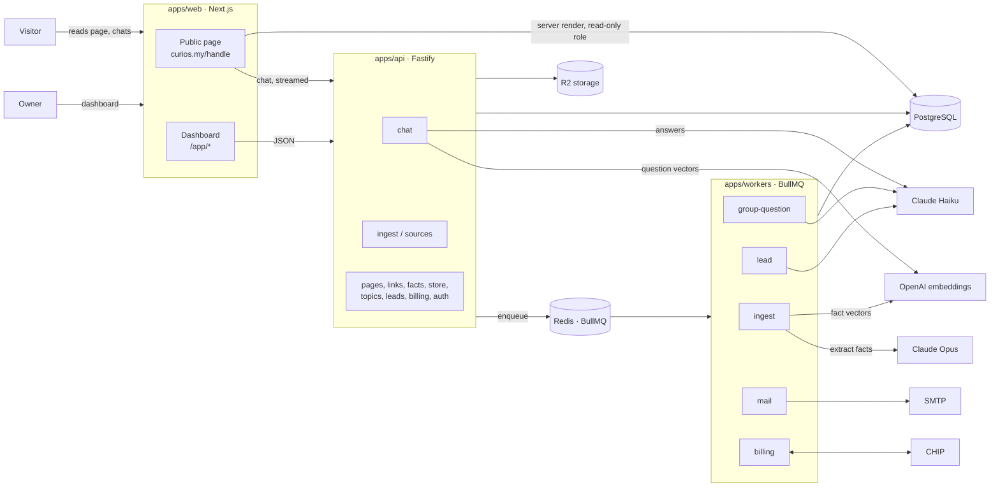
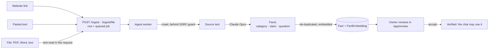
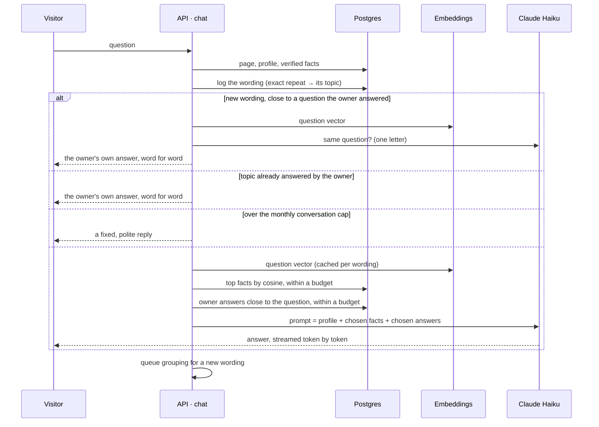

# Curios

A link-in-bio page that answers questions.

A shop or a person puts one link in their bio. Visitors get the links they came
for, and they can also ask the page anything ("berapa harga kek 1kg?", "ada
delivery?"). The page answers in Malay, English or both, using only facts the
owner has approved. When a business visitor is ready to buy, the page takes
their number and emails the owner a lead.

Answering is free on every plan. A business pays for **knowing who asked**: the
leads, the transcripts, and FAQ pages built from what customers really ask.

---

## Tech stack

| Layer | What we use | Why it's here |
|---|---|---|
| Language | TypeScript everywhere, Node 22 | One language from database to browser |
| Monorepo | pnpm workspaces + Turborepo | Three apps and eight packages, built and tested together |
| Web | Next.js 15 (App Router), React 19, CSS Modules | Public pages render on the server; the owner dashboard is client-side |
| API | Fastify 5 + zod | HTTP only. Anything slow is queued, and a request never waits on a model, except chat, which streams |
| Background jobs | BullMQ on Redis 7 | Reading sources, grouping questions, leads, email, billing |
| Database | PostgreSQL 16 + Prisma 6 | Everything, including the embedding vectors (stored as bytes, compared in code) |
| Chat model | Anthropic Claude Haiku 4.5 | Answers visitors, decides whether two questions are the same, pulls details out of leads |
| Extraction model | Anthropic Claude Opus 5 | Turns a website, pasted text or file into reviewed facts |
| Embeddings | OpenAI `text-embedding-3-small`, 512 dimensions | Finding the facts and answers relevant to each question |
| File reading | `unpdf` (PDF), `mammoth` (Word) | A resume or menu uploaded as a source |
| Crawling | `undici` + `cheerio` | Reading an owner's website, behind an SSRF guard |
| Storage | S3-compatible (Cloudflare R2) | Profile pictures and cover photos |
| Payments | CHIP (FPX online banking, card, e-wallet) | One-off purchases: RM49 a month or RM490 a year, plus opt-in card auto-renew |
| Email | SMTP via Nodemailer (Mailpit locally) | Sign-in links and new-lead notifications |
| Auth | Email + password (Argon2) and Google sign-in | Sessions are random tokens, stored only as a hash |
| Tests | Vitest, Testing Library, a "golden" set run against the real models | See [Testing](#testing) |

---

## Architecture



Three processes share one database, and none of them imports another:

- **`apps/web`** renders public pages straight from Postgres through a
  **read-only** database role, so a public page works even when the API is
  busy. The dashboard talks to the API.
- **`apps/api`** handles HTTP. Work that is slow or calls a model (reading a
  source, grouping questions, extracting a lead, sending email) goes on a
  queue. Chat is the one exception: it streams the answer as it's written.
- **`apps/workers`** consumes the queues: `ingest`, `group-question`, `lead`,
  `mail` and `billing`.

### How a page learns: sources → facts → review

The knowledge a page answers from is a list of small **facts**, each with a
category (price, hours, location…), a claim, and the question it answers. The
owner approves every one before the page can say it.



### How a question gets answered: retrieval-augmented

Each visitor question is answered from **only the knowledge it needs**, not the
whole page:



What reaches the model on each turn:

| Part | How much | Notes |
|---|---|---|
| **Profile** | Always, whole | Name, bio and links, so "how do I order?" points to the page's own WhatsApp |
| **Facts** | Top matches by cosine similarity, up to 2,500 characters | Small pages (under 25 facts) send all of theirs, which is under ~1,000 tokens and nothing to save. When nothing is relevant, everything is sent so the model's "I'm not sure" is judged against the whole page. |
| **Owner answers** | All while they fit 2,000 characters, otherwise only the relevant ones | Ranked by the questions visitors actually typed for each topic |
| **Never-say list** | Always | Topics the owner never wants raised |

The model may only state a price, date, address or policy that appears in that
context. Otherwise it says it will check with the owner, and the question shows
up in the dashboard as one to answer.

Vectors live in Postgres as bytes and are compared in code. A page holds tens to
a few hundred facts, so this takes milliseconds. A separate vector database
would add an extension and an operational dependency for no measured gain.
Details in [`devDocs/BACKEND.md`](devDocs/BACKEND.md).

### Questions, topics and leads

- **Topics.** Visitors ask the same thing forty ways. Each new wording is
  embedded, shortlisted against existing topics, and Claude Haiku decides
  whether it's the same question. It's then folded into that topic, so the
  owner answers each one once. Topics asked three or more times with an
  owner's answer become public FAQ pages.
- **Leads (business pages).** When a visitor shows intent to buy, the chat
  offers a one-field capture card. The number is queued, Haiku pulls out what
  they wanted (product, date, place), and the owner gets an email with the
  whole conversation and a one-tap WhatsApp link. The first three leads are
  free.
- **Store (business pages).** An owner lists items, each with one price or a
  list of priced options, and opens a shop at `/handle/shop` with a "Visit
  shop" tile on the page. Customers pay the owner directly by DuitNow QR or
  bank transfer; Curios never holds the money. The chat knows the shelf and
  quotes its prices exactly. For now the basket goes to the owner as a
  WhatsApp message; orders come in a later slice.

---

## Repository layout

```
curios/
├── apps/
│   ├── web/          Next.js: landing page, public pages, owner dashboard
│   ├── api/          Fastify: HTTP and chat streaming, one module per feature
│   └── workers/      BullMQ consumers: ingest, grouping, leads, mail, billing
├── packages/
│   ├── core/         Shared rules and types: plans, caps, retrieval, topics (pure, well tested)
│   ├── db/           Prisma schema, migrations, client, shared write helpers
│   ├── db-read/      Read-only queries the public pages render from
│   ├── gateway/      The model provider boundary (Anthropic): chat, extract, judge, slots
│   ├── embeddings/   The embedding provider boundary (OpenAI) and vector encoding
│   ├── billing/      CHIP client
│   ├── ui/           Shared components and design tokens
│   └── goldens/      Answer-quality evaluation against the real models
├── scripts/          Dev seed and one-off backfills
├── fixtures/         Pages the golden set runs against
└── devDocs/          Design, backend, frontend and operations docs, plus slice specs
```

---

## Running it locally

**You need:** Node 22, pnpm 9, Docker, and API keys for Anthropic and OpenAI.

```bash
# 1. Postgres (dev and test), Redis, and Mailpit for email
docker compose up -d

# 2. Configuration
cp .env.example .env          # then fill in ANTHROPIC_API_KEY, OPENAI_API_KEY, SESSION_SECRET…

# 3. Dependencies and the database client
pnpm install
pnpm db:generate

# 4. Schema and the read-only role the public pages use
set -a; source .env; set +a
pnpm --filter @curios/db exec prisma migrate deploy
docker exec -i curios-postgres psql -U curios -d curios < packages/db/prisma/sql/readonly-role.sql

# 5. Optional: a sample page (Nadia Bakes) to click around
pnpm exec tsx scripts/seed-dev.ts

# 6. Web, API and workers together
pnpm dev
```

| Service | Address |
|---|---|
| Web (landing, public pages, dashboard) | http://localhost:3000 |
| API | http://localhost:3001 |
| Mailpit (see sent email) | http://localhost:8075 |
| Postgres dev / test | `localhost:5452` / `localhost:5453` |
| Redis | `localhost:6399` |

Profile and cover uploads need the `STORAGE_*` settings, and payments need the
`CHIP_*` ones. Without them, those buttons say they're switched off, and
everything else works.

---

## Testing

```bash
pnpm test          # every package, one at a time (they share the test database)
pnpm typecheck
pnpm lint
pnpm goldens       # answer quality against the real models — costs real tokens
```

- **The test database runs in memory**, so restarting its container wipes it.
  If database tests suddenly fail everywhere with `relation "Account" does not
  exist`, restore it as described in
  [`devDocs/OPERATIONS.md`](devDocs/OPERATIONS.md#restoring-the-test-database).
- **Pure rules** (plan limits, retrieval, topic matching) live in
  `packages/core` and are unit-tested without a database.
- **The golden set** asks fixture pages real questions and checks the answers:
  that prices are never invented, and that the right facts are retrieved.

---

## Further reading

| Doc | What's in it |
|---|---|
| [`devDocs/README.md`](devDocs/README.md) | The product: what's free, what's paid, and the settled decisions |
| [`devDocs/BACKEND.md`](devDocs/BACKEND.md) | API, workers, data model, retrieval |
| [`devDocs/FRONTEND.md`](devDocs/FRONTEND.md) | Web app structure and screens |
| [`devDocs/DESIGN.md`](devDocs/DESIGN.md) | Palette, type, motion, and the banned list |
| [`devDocs/OPERATIONS.md`](devDocs/OPERATIONS.md) | Running it, and fixing it when it breaks |
| `devDocs/slice-*-build-spec.md` | How each feature was specified and built |
